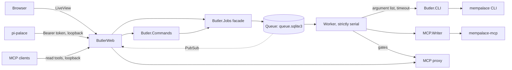

<h1 align="center">Butler</h1>

<p align="center"><strong>A local job queue, worker and dashboard that replace the MemPalace Python daemon</strong></p>

<p align="center">
  <a href="https://github.com/OWNER/butler/actions/workflows/ci.yml">
    
  </a>
  
</p>

---

Butler is a small, local Phoenix LiveView app that **owns the MemPalace job
queue**. It stores jobs in its own SQLite database, runs them one at a time
(ephemeral `mempalace` CLI processes, plus one persistent `mempalace-mcp`
writer for MCP write jobs), exposes a token-protected asynchronous HTTP API
for [pi-palace](docs/api.md), gates the MCP proxy during maintenance, and
shows everything live in a dashboard.

The MemPalace Python daemon is **no longer used**: Butler never reads its
files nor calls it (hard cut, no history import). See
[Replacing the Python daemon](#replacing-the-python-daemon).



The layers only depend downward: LiveViews render and delegate to
`Butler.Commands` / `Butler.Jobs`; anything that spawns a process goes through
`Butler.CLI` (ephemeral jobs) or `Butler.MCP.Worker` (proxy backends and the
writer).

## Installation

Butler runs from source (there is no release package yet). You need
[mise](https://mise.jdx.dev), which installs Erlang/OTP 29 and Elixir 1.20,
and a working [MemPalace](https://github.com/MemPalace/mempalace) installation
with `mempalace` in your `PATH`. Linux only (the legacy-daemon check and the
orphan reaper use `/proc`).

```bash
git clone https://github.com/OWNER/butler.git
cd butler
mise install        # Erlang 29 + Elixir 1.20.3-otp-29
mise run setup      # dependencies and assets
```

## Quickstart

Start Butler (it is a local tool, launched manually):

```bash
mise run server     # http://localhost:4000
```

The job engine starts with the app. Open <http://localhost:4000>:

| Page | What you do there |
|---|---|
| **Worker** | See the worker status (`idle`, `running`, `blocked`), its active job, the job counters and the maintenance flag. |
| **Jobs** | Follow the queue live, filter by state or kind, cancel queued or running jobs, retry failed or cancelled ones (a confirmation is needed for kinds that are not idempotent). Open a job for its live output, tail, result and error. The payload of `diary_write` and `mcp_tool` jobs is never shown. |
| **Launch** | Queue `mine`, `sweep` and `sync` jobs. A sync is a dry run; applying it needs a wing or roots and a confirmation. |
| **Maintenance** | Queue `repair`, `compress` and `migrate-wings` (dry runs included) after a confirmation. Nothing runs from the page: the worker runs the job when its turn comes, and the queue position is shown. |
| **MCP** | See the state of the MCP proxy backends (`full`, `light`), the time before the next rotation, client sessions and requests; force a restart. |
| **Palace** | Placeholder for a future visualization. |

While a maintenance job runs, a banner is shown on every page and the MCP
proxy refuses every request.

Butler watches the palace in `~/.config/mempalace/palace` by default; it can be
pointed elsewhere (see [Configuration](#configuration)).

No MemPalace at hand? `mix butler.demo` runs Butler on synthetic data in a
throwaway state dir; the `mempalace` CLI is then replaced by a stub that
executes nothing.

## Replacing the Python daemon

Two writers must never share a palace. Before using Butler:

1. **Stop the Python daemon** (`mempalace daemon stop`) and keep it stopped.
   Butler's worker stays `blocked` (see the **Worker** page) while the
   daemon's PID is alive.
2. **Set write routing to direct** for your own tools, so that nothing starts
   or forwards to a daemon again (`MEMPALACE_CLI_WRITE_ROUTING=direct`,
   `MEMPALACE_WRITE_ROUTING=direct`, `MEMPALACE_HUB_FORWARD=0`). Butler sets
   these for every process it spawns and adds `--direct` to every command that
   has routing flags.
3. Point pi-palace at Butler's [HTTP API](docs/api.md).

Jobs of the Python daemon are not imported.

## Configuration

Butler monitors a single palace. It is configured with environment variables,
read at startup by `config/runtime.exs`:

| Variable | Default | Meaning |
|---|---|---|
| `BUTLER_PALACE_PATH` | `~/.config/mempalace/palace` | The palace to control. |
| `BUTLER_STATE_DIR` | `$XDG_STATE_HOME/butler`, else `~/.local/state/butler` | Butler's own state: `queue.sqlite3` (mode 600) and the API `token` (mode 600), in a directory of mode 700. |
| `BUTLER_RETENTION_DAYS` | `7` | Terminal jobs (and their payloads) older than this are pruned at startup, then daily. |
| `BUTLER_LOCK_BACKOFF_SECONDS` | `60` | Cooldown before a job refused by the palace lock is claimed again. |
| `BUTLER_MEMPALACE_HOME` | `~/.mempalace` | MemPalace home, shared by every process Butler spawns (and where the legacy daemon is looked for). |
| `MEMPALACE_DAEMON_STATE_ROOT` | `<home>/daemon` | Where the legacy daemon's `endpoint.json` is looked for (PID liveness only). |
| `BUTLER_MEMPALACE_BIN` | `mempalace` | The `mempalace` executable (resolved through `PATH`). |
| `PORT` | `4000` | HTTP port. |
| `BUTLER_MCP_ENABLED` | `true` | `false` disables the MCP proxy. |
| `BUTLER_MCP_ROTATION_MINUTES` | `10` | Idle time after which a backend process is recycled. |
| `BUTLER_MCP_FULL_BIN` | `mempalace-mcp` | Executable of the `full` backend (and of the persistent writer). |
| `BUTLER_MCP_LIGHT_BIN` | `mempalace-light-mcp` | Executable of the `light` backend. |

## HTTP API

pi-palace (the only client) submits `mine`, `sweep`, `sync`, `diary_write` and
`mcp_tool` jobs to `POST /api/v1/jobs` with a Bearer token, and polls
`GET /api/v1/jobs/:id`. See [docs/api.md](docs/api.md) for the contract. The
token is Butler's own, in `<state dir>/token`. `repair`, `compress` and
`migrate-wings` are UI-only.

## MCP proxy

Each agent session normally starts its own `mempalace-mcp` Python process, and
those processes keep their memory. Butler can serve **one shared pair of
processes per backend** over HTTP instead:

| Route | Backend |
|---|---|
| `POST http://localhost:4000/mcp/full` | `mempalace-mcp` (read tools) |
| `POST http://localhost:4000/mcp/light` | `mempalace-light-mcp` (`palace_query`, `palace_exec`, `palace_coordinate`) |

It speaks the MCP "Streamable HTTP" transport in its simplest form: one JSON
request, one JSON answer, an `Mcp-Session-Id` header managed by Butler, no
server-sent events (`GET` answers `405`, `DELETE` ends a session). It is a
**read** proxy: only an allowlist of read tools is forwarded; write tools are
refused ("write tools must be submitted through the Butler API") and go
through the job queue instead. It serves the palace Butler is configured for
(`BUTLER_PALACE_PATH`).

Point an MCP client at it, for example with the HTTP transport of your agent:

```json
{ "mcpServers": { "mempalace": { "type": "http", "url": "http://localhost:4000/mcp/light" } } }
```

How it works:

- Each backend keeps **two** processes: an active one and a warm standby.
- After 10 idle minutes (configurable) the standby takes over, the old process
  is killed (its memory goes back to the system) and a new standby starts. This
  happens even when nobody uses the proxy.
- If the active process crashes, the requests in flight get an error right
  away (nothing is retried) and the standby takes over.
- If a backend cannot start (missing binary, palace error) after 3 attempts in
  a row, it is marked **failed** on the MCP page; **Restart** tries again.
- Sessions belong to Butler, not to a process: rotations and crashes do not
  invalidate them.
- During a maintenance job (`repair`, `compress`, `migrate-wings`) every
  request is answered at once with the JSON-RPC error `-32001` "Maintenance
  in progress, retry later", and the backend processes are stopped until the
  job ends. Reads stay allowed during `mine` and `sweep`.

The routes accept loopback connections only and check the `Host` and `Origin`
headers (against DNS rebinding and web pages aiming at `localhost`). There is
**no authentication** on the MCP routes: anything running on your machine can
use them. The processes' stderr goes to Butler's logs.

## Safety rules

Butler is built to be harmless to your palace. These rules are enforced by the
code and covered by tests:

- Butler reads and writes only **its own** token and queue database, in its
  state directory. It **never reads `~/.mempalace/daemon/**`** (the Python
  daemon's token and queue) and never calls the Python daemon.
- Butler has **no HTTP client**: it only serves HTTP (the dashboard, the API
  and the MCP proxy, on loopback, with `Host` and `Origin` checks).
- Processes are spawned only through `Butler.CLI` (argument lists, timeouts,
  kill by OS pid) and `Butler.MCP.Worker` (proxy backends and the persistent
  writer, which is always stopped before a CLI job).
- Every routine CLI write carries `--direct`, never `--daemon` or
  `--background`, and the routing environment variables force direct writes.
- Payloads are validated before they are queued, with the rules the worker
  applies (absolute paths, whitelisted modes, positive integers, nothing that
  looks like an option, no client-chosen palace).
- `sync` is a dry run by default; `--apply` needs an explicit request, a wing
  or roots, and (in the UI) a confirmation.
- The worker is strictly serial; a failed job is never retried automatically
  (only idempotent jobs interrupted by a crash or shutdown are re-queued, at
  most 3 attempts); the jobs of the maintenance kinds put the MCP proxy in
  maintenance mode and the proxy is always resumed afterwards.
- The payloads of `diary_write` and `mcp_tool` jobs are verbatim content: they
  are never shown in the dashboard nor returned by the API without
  `include_payload=true`, and they are pruned with their job.
- Tests use mocks, a fake MCP backend and throwaway state dirs, with
  **synthetic data** only; they never run destructive commands against a real
  palace.

### Things to know

- **Cancelling a running job** sends `TERM`, then `KILL` after a grace period,
  to its process. A cancelled write job may already have been applied.
- A job refused by the palace lock (held by another process) goes back to the
  queue and is not claimed again for a cooldown.
- Out of scope for now: palace visualization, remote access, several palaces,
  streaming (SSE) and batches in the MCP proxy, migration of the Python
  daemon's history, supervision of Butler itself (systemd...).

## Screenshots

The screenshots were **removed** from the repository: they predated the final
queue/worker dashboard and showed a demo queue with a `running` row. Generate
fresh ones (light and dark, into `docs/screenshots/`) with
`mise run screenshots`. It takes them in demo mode, on synthetic data
(`mix butler.demo`: a fake palace and a generated queue of queued and finished
jobs; no `mempalace` command is ever run in that mode), and needs node and a
Chromium (`CHROMIUM_PATH`, default `/usr/bin/chromium`). Butler follows the
system theme by default; the toggle at the bottom of the sidebar switches
between system, light and dark.

## Documentation

| To... | Read |
|---|---|
| Install and try it | [Installation](#installation), [Quickstart](#quickstart), [Screenshots](#screenshots) |
| Leave the Python daemon | [Replacing the Python daemon](#replacing-the-python-daemon) |
| Configure it | [Configuration](#configuration) |
| Call it from pi-palace | [docs/api.md](docs/api.md) |
| Trust it | [Safety rules](#safety-rules) |
| Understand or change it | [CONTRIBUTING.md](CONTRIBUTING.md), [AGENTS.md](AGENTS.md), [docs/plan.md](docs/plan.md) |

## Contributing

See [CONTRIBUTING.md](CONTRIBUTING.md).

## License

MIT — see [LICENSE](LICENSE).
